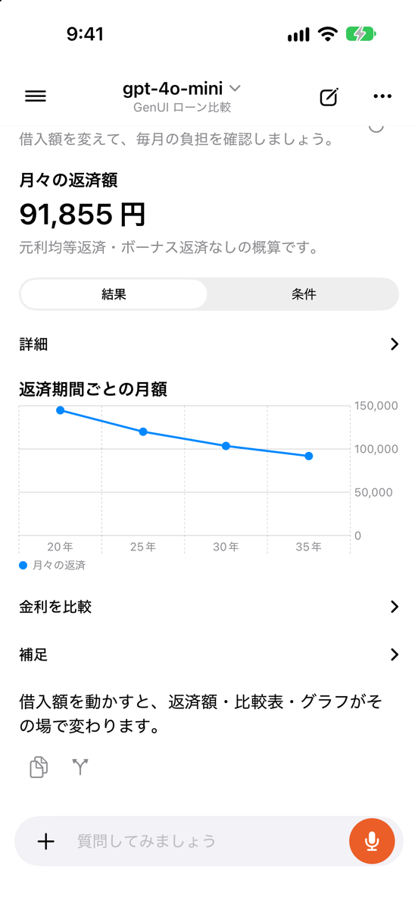
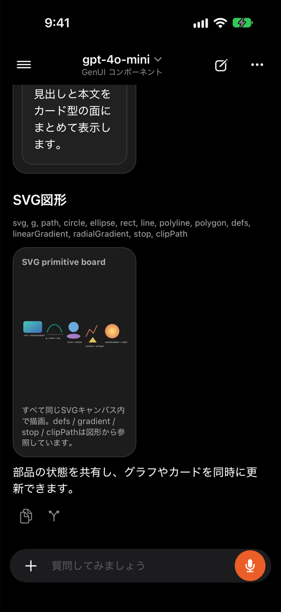
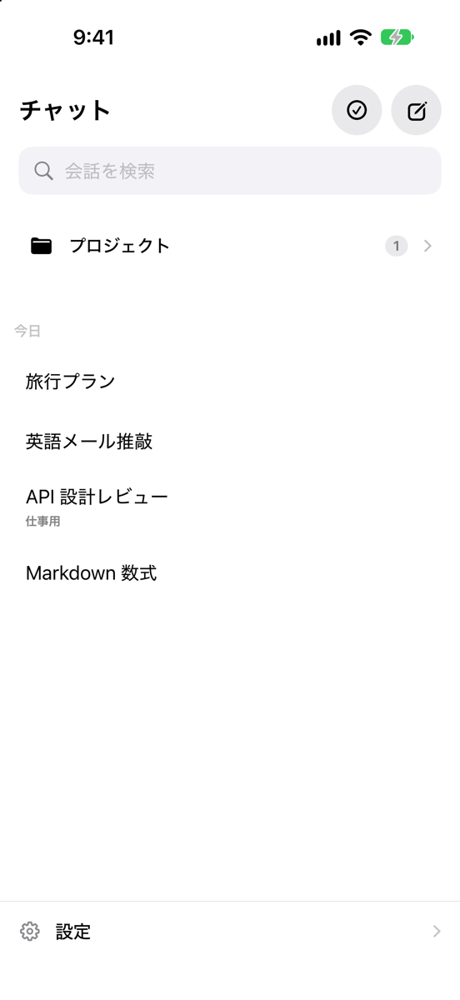

<div align="center">


# YamabikoChat

**iPhone・iPadのためのネイティブAIチャットスタジオ。**<br>
1つのプロンプトを、複数のモデルへ — 回答を並べて比較し、モデル同士に議論させ、<br>
複数の応答を1つの結論へ融合できます。

[English](README.md) · **日本語** · [简体中文](README.zh-Hans.md)

<a href="https://apps.apple.com/jp/app/yamabikochat-ai%E3%83%81%E3%83%A3%E3%83%83%E3%83%88/id6771687018"></a>

[](https://github.com/porarrirr/yamabikochat/releases)

[](LICENSE)

</div>

---

**YamabikoChat**（山彦）は、「どのモデルも常に正しいわけではない」という発想から生まれたSwiftUIネイティブのAIクライアントです。1つのモデルと会話する、2つのモデルを並べて比較する、モデル同士に自律的に会話させる、パネル → ジャッジ → シンセサイザーのパイプラインを回す — すべて1つのアプリで、あなたのデバイス上で行えます。

> 対応プラットフォームはiOS・iPadOSのみです。Android版の開発は終了しており、過去の実装はGit履歴に残っています。既定の開発ブランチは `ios` です。

## スクリーンショット

| チャット · コードと数式 | GenUIによる対話的な回答 | ダークモード | 会話ライブラリ |
|:-:|:-:|:-:|:-:|
|  |  |  |  |

| iPad 分割表示 |
|:-:|
|  |

## 機能

### 4つの会話モード

- **チャット** — ストリーミング応答、編集・再生成、応答バリアントを備えた標準の1対1会話。
- **デュアル** — 同じプロンプトを2つのモデルに送り、回答を並べて比較。
- **自動会話** — 2つのモデル・話題・ターン数を指定して、モデル同士の会話を観察。
- **Fusion** — 質問を複数のパネルモデルへ並列に投げ、ジャッジモデルが構造化された比較（合意点・矛盾点・独自の洞察・疑わしい誤り）を生成し、シンセサイザーが最終回答を書き上げます。quality / budget / fast プリセットと、完全なカスタムJSONを同梱。

### プロバイダー

| プロバイダー | 接続方法 |
|---|---|
| Google Gemini | APIキーまたはGoogleログイン（OAuth） |
| ChatGPTプラン | OpenAIアカウントでサインイン — ChatGPTサブスクリプションを利用 |
| OpenAI | APIキー |
| OpenRouter | APIキー — アプリ内で全モデルディレクトリを参照可能 |
| SuperGrok（xAI） | xAIアカウントでサインイン |
| Z.ai · MiniMax | APIキー |
| OpenCode Go · ClinePass · Alibaba Coding Plan | プラン認証情報。アプリ内で利用量を確認可能 |
| Sarashina | APIキー |
| Apple Intelligence | 標準搭載 — オンデバイス・Private Cloud Compute。キー不要 |
| カスタムエンドポイント | 任意のOpenAI互換ベースURL + キー |
| models.devカタログ | モデル単位の通信契約で解決される追加プロバイダー |

モデルの識別と実行は、内蔵の [Pi Agentsランタイム](ios/PiRuntime/) が解決します。非対応モデルはプロトコルを推測してごまかすのではなく、理由を明示したうえで無効状態のまま表示されます。

### クライアント側ツール

- **Web検索** — モデルが回答途中で呼び出せるDuckDuckGoフェデレーテッド検索。
- **Python** — 組み込みPythonランタイムがモデルの書いたコードを実行し、出力とファイルを返します。
- **GenUI** — モデルがインタラクティブなグラフ・カード・SVGグラフィックスをネイティブ描画するUIで回答できます。
- **ファイルエディター・ユーザー確認** — 構造化された編集と、実行途中の質問確認。

### レンダリング

- Markdown（swift-markdown）、表、ワンタップでコピーできるシンタックスハイライト付きコードブロック。
- MathJax数式。
- CEL評価によるインタラクティブ性を備えたGenUIリッチドキュメント。

### iOS・iPadOSへの最適化

- **Siri・ショートカット・App Intents** — 「やまびこチャットに質問」でハンズフリーに尋ねたり、保存済みのモデル・Fusionプリセットをショートカットから実行。
- **Spotlight** — 会話タイトルを索引して検索可能に。オンスクリーンコンテキストにより、表示中のチャットをSiriから参照できます。
- **シークレット会話** — Spotlight・Siri・エンティティ解決の対象から完全に除外。
- **共有エクステンション** — 他のアプリのテキストを新規チャットへ直接送信。
- **添付ファイル** — 画像・PDF・テキストを1ファイル最大10MBまで。
- **整理機能** — プロジェクト、履歴検索、モデルプリセット、メッセージ単位のトークン使用量統計。
- **ダークモード** と iPad向け分割表示。
- UIは English・日本語・简体中文・Español・Français に対応。

## プライバシーとデータの取り扱い

- プロンプト、リクエストに含まれる会話コンテキスト、選択した添付ファイルは、**設定したプロバイダーにのみ**送信されます。カスタム接続先や追加ツールのデータ取扱いは、それぞれの運営者の規約に従います。
- API認証情報はiOSのKeychainに保存されます。
- Apple Intelligenceへのリクエストは、オンデバイスまたはAppleのPrivate Cloud Computeで処理されます。
- 内蔵の診断ロガーがネットワーク・認証エラーをカテゴリとメタデータ付きで記録し、アプリ内で確認できます — Xcodeは不要です。

機密情報を送信する前に、送信先プロバイダー、ベースURL、有効なツールを確認してください。

## ダウンロード

署名済み・未署名ビルドを [GitHub Releases](https://github.com/porarrirr/yamabikochat/releases) で公開しています。CIで生成されたiOS成果物は未署名の場合があり、通常の端末へそのままインストールできるとは限りません。TestFlight配信は別の手動ワークフローで行います。

## ソースからビルド

必要条件: macOS、Xcode 27、[XcodeGen](https://github.com/yonaskolb/XcodeGen)、Node.js 24。

```bash
cd ios
./bootstrap.sh        # 依存関係の復元、Piのビルド、Xcodeプロジェクトの生成
open YamabikoChat.xcodeproj
```

テストスイートの実行:

```bash
cd ios && xcodegen generate
xcodebuild -project YamabikoChat.xcodeproj -scheme YamabikoChat \
  -destination 'platform=iOS Simulator,name=iPhone 18 Pro,OS=27.0' \
  CODE_SIGNING_ALLOWED=NO test
npm test --prefix ios/PiRuntime          # Piランタイムのテスト
npm test --prefix ios/GenUIRuntimeTests  # GenUI DOMテスト
```

ブートストラップのキャッシュ、ターゲット、CIの詳細は [ios/README.md](ios/README.md) を参照してください。

## リポジトリ構成

| 場所 | 用途 |
|---|---|
| [ios/YamabikoChat/](ios/YamabikoChat/) | SwiftUIアプリ — 機能、データ層、Piブリッジ、App Intents |
| [ios/YamabikoShareExtension/](ios/YamabikoShareExtension/) | テキスト取り込み用の共有エクステンション |
| [ios/YamabikoTests/](ios/YamabikoTests/) | ユニットテスト |
| [ios/PiRuntime/](ios/PiRuntime/) | Pi AgentsランタイムとJSテスト |
| [ios/docs/](ios/docs/README.md) | 開発メモとデザイン検証資料 |
| [docs/](docs/README.md) | 公開サイト — プライバシー、サポート、規約、Fusion解説 |
| `scripts/` | 上流プロバイダー契約の検証 |
| `third_party/` | 第三者ソフトウェアの契約・ライセンス資料 |

## ライセンス

独自コードは [MIT License](LICENSE) で公開しています。同梱・復元される第三者ソフトウェアには個別のライセンスが適用されます — 詳細は [THIRD_PARTY_NOTICES.md](THIRD_PARTY_NOTICES.md) を参照してください。
